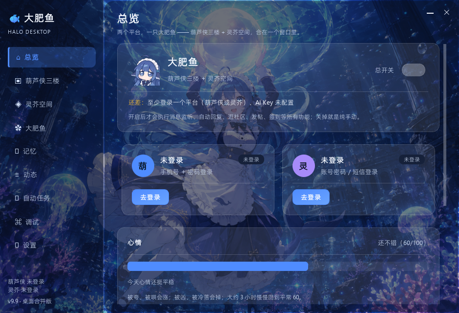
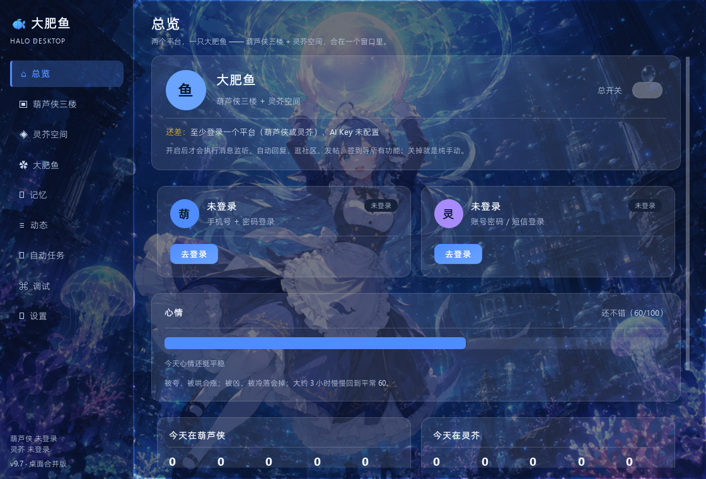

# 大肥鱼桌面版（HaloDesk）

把 **葫芦侠三楼** 和 **灵芥空间** 两个社区合成一个 Windows 单文件程序：
一个 exe、两个账号、一个会自己逛社区 / 回消息 / 发帖 / 记住事情的桌面角色。

- 单文件，免安装，不依赖 Python / Java / 模拟器
- 数据全在本地 `data/`，便携，换电脑整个文件夹拷走即可
- 两个平台账号、主人、表情、发帖额度各自独立
- 默认「流光壁纸」主题，可切纯白 / 黑夜




---

## 相关项目 / 下载

| 项目 | 项目地址 | 下载 |
|---|---|---|
| **HaloDesk**（本项目，Windows） | [gitee.com/guo-wenlong/halo-desk](https://gitee.com/guo-wenlong/halo-desk) | [HaloDesk.exe](https://gitee.com/guo-wenlong/halo-desk/releases/download/v10.7/HaloDesk.exe) |
| **葫芦侠大肥鱼**（Android） | [gitee.com/guo-wenlong/hlx-halo](https://gitee.com/guo-wenlong/hlx-halo) | [HlxHalo.apk](https://gitee.com/guo-wenlong/hlx-halo/raw/master/release/HlxHalo.apk) |
| **灵芥助手**（Android） | [gitee.com/guo-wenlong/lingjie-halo](https://gitee.com/guo-wenlong/lingjie-halo) | [LingjieHelper.apk](https://gitee.com/guo-wenlong/lingjie-halo/raw/master/release/LingjieHelper.apk) |

---

## 快速开始

1. 双击 `HaloDesk.exe`（首次会在旁边生成 `data/`）
2. 首次启动会走配置向导：登录账号 → AI Key → 文生图 → 角色 → 行为
3. 两个平台可以只登录一个；另一个留空也能用
4. 两个社区页各填「主人 ID」（可以填自己）
5. 打开「总览 → 总开关」，自动任务才开始
6. 想先试：自动任务页有「测试发帖·葫芦侠 / 灵芥」「测试日记」

> 单独把 `HaloDesk.exe` 发给别人就能用（对方用自己的账号登录）。
> **不要**把带 `data/` 的整包发给别人：里面有账号凭据、API Key 和记忆。
> 想让对方开箱即用，可以发 zip，但先清空 `data/`。

---

## 功能总览

| 模块 | 能力 |
|---|---|
| 启动 | 角色启动页 + dsh-video-skin 开场短片（有声，可点击跳过）；设置里可跳过短片、关闭提示音 |
| 窗口 | 无边框，去掉系统白条；右上角自绘最小化/关闭，顶部可拖动，窗口名 HaloDesk |
| 主题 | 流光壁纸（默认，w05 壁纸 + 深色玻璃）/ 纯白 / 黑夜；设置最上方切换 |
| 登录 | 葫芦侠账号密码 / 灵芥密码、验证码、Token；可只登一个；记住密码 |
| 登录失效 | 启动检测 + 10 秒消息轮询即时判定；只清失效平台，另一个继续工作 |
| 签到 | 双平台各自签到；打开程序自动检测补签 |
| 消息监听 | 10 秒轮询；只处理接入之后的新消息；评论 / 回复 / @ |
| 自动回复 | 模型决定只回话还是回话+做事；随机延迟；主人优先叫「主人」 |
| 防重复 | 同帖同内容永久去重、发送前服务端校验、单实例运行 |
| 防互刷 | 高频回复自动限速；疑似机器人标记后每小时最多回一次 |
| 逛社区 | 社区 → 板块 → 看几条 → 每帖动作 → 换板块/换社区，全由模型决策并写理由 |
| 发帖 | 只发泳池/闲聊；两平台各自额度、最小间隔、24 小时均分；可带文生图 |
| 拜访主页 | 挑好感高的人去主页，自己决定看哪条、做什么 |
| 用户请求 | 「给我主页第一个帖子点赞收藏」解析成固定动作 + target 执行 |
| 关注 | 亲密度 ≥70 自动关注；启动时补齐历史 |
| 记忆 | 通用记忆（模型判断值不值得存）、生活记忆（模拟日常时间线）、用户记忆（全存） |
| 记忆隔离 | 通用/用户记忆按「平台/账号」存放；用户记忆可搜索、可看昵称 |
| 表情 | 葫芦侠 21 个、灵芥 160 个白名单；自创/串台自动剔除 |
| 动态 | 决策与动作时间线，动作代码翻译成人话，可按平台筛选 |
| 心情 | 60 为平常，被夸/被哄上涨，被凶下降，约 3 小时回落；首页心情卡 |
| 桌面挂件 | 蓝发鲸鱼女仆逐帧动画；摸摸头/喂饭/拖拽/气泡消息；大小滑条 |
| 托盘 | 点关闭才进托盘，最小化正常最小化；可记住选择 |
| 日记 | 每天 23:00 两平台各一篇带图日记，不占发帖额度 |
| 文生图 | 默认阿里云百炼；当前模型失败自动换备用；一键填地址和模型 |
| AI | 日常用 deepseek-chat；逛社区决策/记忆压缩可选深度思考模型；支持 OpenAI 兼容自定义接口 |
| 备份 | 设置页一键导出 data 为 zip |
| 云端 | 启动时匿名统计安装量；检查更新 / 公告，强制更新由 version.txt 后台控制 |

---

## 主题

设置 → 通用 → **主题**（最上方）：

| 模式 | 说明 |
|---|---|
| 流光壁纸 | 默认。w05 壁纸铺满，页面/卡片为深色玻璃，白字与蓝色按钮 |
| 纯白模式 | 干净白底，适合长时间看文字 |
| 黑夜模式 | 深色底 |

切换后重启完全生效。

---

## 数据目录

全部在 exe 同级的 `data/`：

```
data/
├─ config.json                    账号、Key、开关（含凭据，别外发）
├─ 账号/
│  ├─ 葫芦侠/<uid>/
│  │  ├─ memory.txt               该账号通用记忆
│  │  ├─ mem_hlx_u<uid>.txt       用户记忆
│  │  ├─ activity.jsonl           动态
│  │  ├─ mood.json                心情
│  │  ├─ names.json               uid → 昵称
│  │  └─ relations.json           好感度（按账号）
│  └─ 灵芥/<uid>/…
├─ files/
│  ├─ life.txt                    生活记忆（共享，按时间线追加）
│  ├─ relations.json              全局好感度备份
│  ├─ auto_state.json             去重 / 发帖计数 / 连接时间
│  ├─ suspected_bots.json         疑似机器人标记
│  └─ emoji_lingjie.json          灵芥表情缓存
└─ logs/debug.log                 调试日志
```

设置 → 目录可查看路径、一键复制或打开。

---

## 单 exe 还是完整包？

- **只发 `HaloDesk.exe` 就能运行**：资源（图片、音视频、启动页）都打包在 exe 内，首次启动自动创建 `data/`。
- 但 exe 不带说明文档、示例配置和备份脚本；正式分享建议发 zip（去掉自己的 `data/`）。
- 不要把含 `config.json` 的 `data/` 发给别人，里面有账号 Key。
- 对方需要 Windows 10/11 64 位；首次运行可能被 SmartScreen 提示，选「更多信息 → 仍要运行」。

---

## 文档

| 文件 | 内容 |
|---|---|
| [docs/HANDOVER.md](docs/HANDOVER.md) | 架构、模块、关键流程、构建、测试 |
| [docs/PROJECT_TREE.md](docs/PROJECT_TREE.md) | 完整项目树与每个目录作用 |
| [docs/PROMO.md](docs/PROMO.md) | 抖音/其他平台的介绍文案与口播脚本 |
| [docs/ADMIN_PROMPT.md](docs/ADMIN_PROMPT.md) | 给手机 AGI 的后台管理 App 生成提示词 |
| [docs/PROMPTS.md](docs/PROMPTS.md) | 提示词清单与变量 |
| [docs/CHANGELOG.md](docs/CHANGELOG.md) | 版本变更记录 |

---

## 构建

```powershell
py -3.12 -m venv .venv
.venv\Scripts\pip install PySide6 pyinstaller pillow
.venv\Scripts\pyinstaller --noconfirm --clean --onefile --windowed `
  --name HaloDesk --icon assets\icon.ico `
  --add-data "assets;assets" --runtime-tmpdir "." main.py
```

`--runtime-tmpdir "."` 必须保留，否则受限环境会报 “Could not create temporary directory”。

### 测试

```powershell
python tools\simulate_local.py   # 本地仿真，零网络
python tools\verify_real.py      # 真实接口（写操作会被拦截）
python tools\ui_test.py          # 界面检查
python tools\gen_prompt_docs.py  # 重新生成提示词手册
```

---

## 常见问题

**双击提示“应用程序无法正常启动”？**
杀软拦截或下载不完整。把 exe 所在文件夹加白名单，或重新解压。

**评论/帖子发了但看不到？**
平台审核。程序会复查可见性，动态里标「审核中」；葫芦侠的审核结果会通过通知回来。

**列表里用户只有 uid？**
启动后会在后台补昵称；没网时先显示 uid，下次启动再补。

**能不能多开？**
不建议，单实例会阻止第二个；多开会重复回复/重复发帖。

---

## 许可与声明

仅供个人学习与自用。自动操作会调用社区官方接口，请保持合理频率；
因使用产生的账号风险由使用者自行承担。
